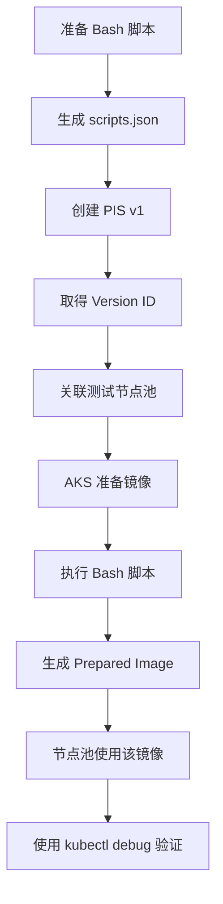

# AKS Prepared Image Specification：Linux Bash 脚本端到端示例

本文演示如何将 Linux Bash customization script 配置到 Azure Kubernetes Service (AKS) 的 Prepared Image Specification (PIS)，并将 PIS 版本关联到测试节点池，最后验证脚本产生的结果。

> **重要：** PIS 不要求上传 `.sh` 文件，也不接受脚本 URI。正确方式是将 Bash 脚本全文作为纯文本写入 `customizationScripts[].script`，然后通过 `--customization-scripts @scripts.json` 提交；不需要 Base64 编码。每个脚本还需提供 `name`、`scriptType` 和 `executionPoint`。如果要将修改固化到最终节点镜像，使用 `NodeImageBuildTime`。
>
> PIS 目前为预览功能。使用前请阅读[官方 PIS 文档](https://learn.microsoft.com/en-us/azure/aks/prepared-image-specification-overview)，确认当前适用范围、要求和限制。

## 工作流程



官方文档说明，AKS 会创建临时 build node、应用 customization 并生成 prepared image。如果同时配置脚本和容器镜像，脚本先执行；脚本成功后才缓存容器镜像。

## 适用性结论：每天重建节点池时不要默认使用 PIS

PIS 将镜像准备放进 node pool create/update 流程。它更适合镜像准备一次后，节点池继续多次 scale-out 的场景；如果每天删除并新建节点池，每次创建都可能再次触发镜像准备，初始创建会明显变慢。Microsoft Learn 也指出，初始 node pool create/update 会因先构建镜像而耗时更长，PIS 的收益主要来自后续 scale-out。

本项目在同一 AKS 集群、同一 `Standard_D4as_v6` SKU 上做了对照：

| 路径 | AKS operation | 节点状态 | 观测 |
| --- | ---: | --- | --- |
| 新建池并引用 PIS | 17:02、18:20 | `Ready` | 两次均出现临时 PIS builder；PIS 脚本约 22 秒完成 |
| 新建池并引用 PIS（仅 `echo`） | 18:00 | `Ready` | Run Command 22.8 秒；builder deallocate 后到目标 VMSS 创建间隔 13:16 |
| 新建池，不引用 PIS | 1:19 | `Ready` | Ubuntu 24.04.5、Kubernetes 1.35.7 |

简单脚本的 PIS 对照仍耗时 18 分钟，与审阅包脚本的 17–18 分钟处于同一范围，因此脚本复杂度不是主因。普通池对照只用 1 分 19 秒；本示例仅把审阅文件复制到镜像，没有预缓存容器镜像或其他耗时初始化，PIS 没有抵消这段创建耗时的实际收益。**若目标是每日新建节点池，使用普通 AKS node pool，不传 `--prepared-image-specification-id`。** 仅当镜像预热或 OS customization 能在后续重复扩容中带来可测量收益时，才考虑 PIS。

Microsoft Learn 没有给出 PIS 初次构建的分钟数或时长 SLA；文档只说明初次 node pool create/update 会先构建镜像，因此会耗时更长。测试中约 13 分钟的等待发生在简单脚本和 generalize 完成之后、目标 VMSS 创建之前；公开 Activity Log 不显示 PIS 服务内部每个子阶段，因此不能进一步断言是某个具体快照/捕获步骤。

## 1. 前置准备

本示例使用 Ubuntu Linux 节点。按官方文档要求，准备 Azure CLI 2.85.0 或更高版本、`aks-preview` 扩展 21.0.0b5 或更高版本，并注册 `AKSPreparedImageSpecificationPreview` 功能。Linux PIS 支持的 OS SKU 请以[官方 PIS 文档](https://learn.microsoft.com/en-us/azure/aks/prepared-image-specification-overview)为准。

### AKS Kubernetes 版本要求

Microsoft Learn 的 PIS [创建与管理文档](https://learn.microsoft.com/en-us/azure/aks/prepared-image-specification)要求现有 AKS 集群运行**受支持的 Kubernetes 版本**，但没有指定 PIS 专属的最低 Kubernetes minor 或 patch 版本。因此，不应推断 PIS 必须使用某个特定版本（例如 `1.35`）；应以 [AKS 当前支持版本及其生命周期](https://learn.microsoft.com/en-us/azure/aks/supported-kubernetes-versions)和目标区域的 `az aks get-upgrades` / `az aks nodepool get-upgrades` 结果为准。

这与 PIS 自身的预览前置条件不同：官方列出了 Azure CLI / `aks-preview` 版本、订阅 feature 注册、公共区域范围和支持的 OS；它们不是 Kubernetes 版本下限。AKS Kubernetes 升级时，会为节点池引用的 PIS version 自动重新生成 prepared VHD；无需仅为 Kubernetes 版本变化创建新的 PIS version。脚本或容器镜像内容变更时应创建新 PIS version；PIS 概述另建议在 AKS node image 更新时通过新版本保持 prepared image 更新。Kubernetes 版本升级与 AKS node image 更新是不同操作，应分别依据[创建与管理文档](https://learn.microsoft.com/en-us/azure/aks/prepared-image-specification)和[PIS 概述](https://learn.microsoft.com/en-us/azure/aks/prepared-image-specification-overview)执行。

本项目的 canary 实测覆盖了 Kubernetes `1.35.7` 上创建 PIS node pool，以及随后将 PIS node pool 升级到 `1.36.1`，两者均成功。这是已验证组合的实测证据，不代表 PIS 支持范围的最低/最高版本声明。

```bash
az --version

az extension add --name aks-preview --upgrade
az extension show \
  --name aks-preview \
  --query '{name:name,version:version}' \
  --output table

az feature register \
  --namespace Microsoft.ContainerService \
  --name AKSPreparedImageSpecificationPreview

az feature show \
  --namespace Microsoft.ContainerService \
  --name AKSPreparedImageSpecificationPreview \
  --query properties.state \
  --output tsv

# 上一步显示 Registered 后执行
az provider register --namespace Microsoft.ContainerService
```

设置本示例使用的变量，并选择订阅：

```bash
export RESOURCE_GROUP="rg-aks-pis-demo"
export CLUSTER_NAME="aks-pis-demo"
export LOCATION="eastus"
export PIS_NAME="pis-ubuntu-tools"
export PIS_VERSION="v1"
export NODE_POOL="pistest"

az account set --subscription "<subscription-id>"
```

PIS version 必须与目标 node pool 位于同一区域。创建或关联前，也应确认目标区域、VM SKU 和订阅配额满足要求。

## 2. 准备 Bash customization script

以下脚本面向 Ubuntu AKS node image，展示三类修改：

- **A：** 安装 `ca-certificates`、`curl`、`jq` 软件包。
- **B：** 写入并应用 `sysctl` 配置。
- **C：** 下载示例配置文件，并生成校验和。

脚本设计为可重复执行，并对失败显式报错。示例要求 root 权限；PIS 官方文档没有明确规定脚本执行 UID，因此脚本会在权限不符时失败，而不是静默产生不完整镜像。

```bash
cat > pis-customize.sh <<'BASH'
#!/usr/bin/env bash
set -Eeuo pipefail
IFS=$'\n\t'

LOG_FILE="/var/log/pis-customization.log"
mkdir -p "$(dirname "${LOG_FILE}")"
exec > >(tee -a "${LOG_FILE}") 2>&1

trap 'rc=$?; echo "[ERROR] line=${LINENO} command=${BASH_COMMAND} rc=${rc}"; exit "${rc}"' ERR

echo "[INFO] PIS customization started at $(date -u +%FT%TZ)"

# PIS documentation does not explicitly publish the execution UID.
if [[ "$(id -u)" -ne 0 ]]; then
    echo "[ERROR] This customization requires root privileges."
    exit 1
fi

if [[ ! -f /etc/os-release ]]; then
    echo "[ERROR] Unable to identify operating system."
    exit 1
fi

. /etc/os-release
echo "[INFO] Detected OS: ${ID:-unknown} ${VERSION_ID:-unknown}"

if [[ "${ID:-}" != "ubuntu" ]]; then
    echo "[ERROR] This example is intended for Ubuntu node images only."
    exit 1
fi

###############################################################################
# A. Install OS packages/tools
###############################################################################
export DEBIAN_FRONTEND=noninteractive

required_packages=(
  ca-certificates
  curl
  jq
)

missing_packages=()

for package in "${required_packages[@]}"; do
    if ! dpkg-query -W \
         -f='${db:Status-Status}' "${package}" 2>/dev/null \
         | grep -q "installed"; then
        missing_packages+=("${package}")
    fi
done

if (( ${#missing_packages[@]} > 0 )); then
    echo "[INFO] Installing packages: ${missing_packages[*]}"
    apt-get update -y
    apt-get install -y --no-install-recommends "${missing_packages[@]}"
    rm -rf /var/lib/apt/lists/*
else
    echo "[INFO] Required packages are already installed."
fi

###############################################################################
# B. Persist and apply an OS/sysctl setting
###############################################################################
SYSCTL_FILE="/etc/sysctl.d/99-pis-example.conf"

cat > "${SYSCTL_FILE}" <<'EOF'
# Managed by AKS Prepared Image Specification.
# Increase the number of inotify watches available to workloads.
fs.inotify.max_user_watches = 524288
EOF

chmod 0644 "${SYSCTL_FILE}"
sysctl --system

actual_value="$(sysctl -n fs.inotify.max_user_watches)"
if [[ "${actual_value}" != "524288" ]]; then
    echo "[ERROR] Unexpected fs.inotify.max_user_watches=${actual_value}"
    exit 1
fi

echo "[INFO] sysctl value verified: ${actual_value}"

###############################################################################
# C. Download a public example model artifact
###############################################################################
ARTIFACT_DIR="/opt/pis-artifacts"
ARTIFACT_FILE="${ARTIFACT_DIR}/bert-base-uncased-config.json"
ARTIFACT_URL="https://huggingface.co/google-bert/bert-base-uncased/resolve/main/config.json"

install -d -o root -g root -m 0755 "${ARTIFACT_DIR}"

# Do not download again when a valid artifact already exists.
if [[ -s "${ARTIFACT_FILE}" ]] && jq -e . "${ARTIFACT_FILE}" >/dev/null; then
    echo "[INFO] Existing artifact is valid; download skipped."
else
    tmp_file="$(mktemp "${ARTIFACT_DIR}/artifact.XXXXXX")"
    trap 'rm -f "${tmp_file:-}"' EXIT

    curl \
      --fail \
      --location \
      --silent \
      --show-error \
      --retry 5 \
      --retry-delay 2 \
      --connect-timeout 15 \
      --max-time 180 \
      --output "${tmp_file}" \
      "${ARTIFACT_URL}"

    test -s "${tmp_file}"
    jq -e . "${tmp_file}" >/dev/null

    install -o root -g root -m 0444 \
      "${tmp_file}" "${ARTIFACT_FILE}"

    rm -f "${tmp_file}"
    trap - EXIT
fi

sha256sum "${ARTIFACT_FILE}" > "${ARTIFACT_FILE}.sha256"
chmod 0444 "${ARTIFACT_FILE}.sha256"

cat > /etc/pis-example-release <<EOF
pisVersion=v1
artifact=${ARTIFACT_FILE}
completedAt=$(date -u +%FT%TZ)
EOF
chmod 0444 /etc/pis-example-release

echo "[INFO] Installed packages:"
dpkg-query -W -f='${Package} ${Version}\n' "${required_packages[@]}"

echo "[INFO] Artifact:"
ls -l "${ARTIFACT_FILE}" "${ARTIFACT_FILE}.sha256"

echo "[INFO] PIS customization completed successfully at $(date -u +%FT%TZ)"
BASH

chmod 0755 pis-customize.sh
bash -n pis-customize.sh
```

### 下载示例的生产环境注意事项

上面的公开 URL 仅用于 PoC。生产环境建议：

- 使用企业控制、不可变且版本化的 URL，并固定 artifact 版本。
- 在脚本中校验预先保存的 SHA-256 值，而不是仅生成校验和。
- 不要将 SAS、Storage key、token 或密码写入脚本。

PIS customization script 是纯文本内容，不应包含 secrets。受限网络环境下，应先验证 build node 能否访问所需 HTTPS 地址。

## 3. 将 `.sh` 内容打包为 `scripts.json`

`--customization-scripts` 接收 JSON 字符串或 `@json-file`。`script` 字段必须包含脚本全文，而不是本地文件路径、URI 或 Base64 内容。

使用 `jq --rawfile` 读取文件，可以正确处理脚本中的换行和引号：

```bash
jq -n \
  --rawfile script pis-customize.sh \
  '[
    {
      "name": "install-tools-sysctl-artifact",
      "scriptType": "Bash",
      "executionPoint": "NodeImageBuildTime",
      "postScriptAction": "None",
      "script": $script
    }
  ]' > scripts.json

jq . scripts.json
```

生成的 JSON 结构如下：

```json
[
  {
    "name": "install-tools-sysctl-artifact",
    "scriptType": "Bash",
    "executionPoint": "NodeImageBuildTime",
    "postScriptAction": "None",
    "script": "#!/usr/bin/env bash\n..."
  }
]
```

| 字段 | 本例值 | 含义 |
| --- | --- | --- |
| `name` | `install-tools-sysctl-artifact` | PIS 内唯一名称；仅使用小写字母、数字、`.`、`-`。 |
| `scriptType` | `Bash` | 脚本类型；schema 还列出 `PowerShell`。 |
| `executionPoint` | `NodeImageBuildTime` | 在节点镜像构建期间执行，适用于将修改固化到 prepared image。 |
| `postScriptAction` | `None` | 脚本后的操作；schema 还列出 `RebootAfter`。 |
| `script` | Bash 全文 | 纯文本脚本内容，不得包含 secrets。 |

Schema 还列出 `NodeProvisionTime`，但官方 PIS 文档没有完整说明其运行语义、日志和失败处理。对于安装软件包、配置 sysctl、下载文件并将其固化到镜像的场景，使用 `NodeImageBuildTime`。

## 4. 创建 PIS 及其版本

```bash
az aks prepared-image-specification create \
  --resource-group "${RESOURCE_GROUP}" \
  --name "${PIS_NAME}" \
  --version "${PIS_VERSION}" \
  --location "${LOCATION}" \
  --customization-scripts @scripts.json
```

如需同时预缓存容器镜像：

```bash
az aks prepared-image-specification create \
  --resource-group "${RESOURCE_GROUP}" \
  --name "${PIS_NAME}" \
  --version "${PIS_VERSION}" \
  --location "${LOCATION}" \
  --customization-scripts @scripts.json \
  --container-images \
    "<acr-name>.azurecr.io/model-server:v1" \
    "<acr-name>.azurecr.io/inference:v1"
```

脚本会先运行，成功后才开始缓存容器镜像。避免在脚本中随意修改 containerd、registry、certificate、credentials 或 networking 配置，以免影响后续镜像缓存或拉取。

查看 PIS 和版本：

```bash
az aks prepared-image-specification show \
  --resource-group "${RESOURCE_GROUP}" \
  --name "${PIS_NAME}" \
  --output jsonc

az aks prepared-image-specification version show \
  --resource-group "${RESOURCE_GROUP}" \
  --pis-name "${PIS_NAME}" \
  --name "${PIS_VERSION}" \
  --output jsonc
```

取得版本资源 ID：

```bash
export PIS_VERSION_ID="$(
  az aks prepared-image-specification version show \
    --resource-group "${RESOURCE_GROUP}" \
    --pis-name "${PIS_NAME}" \
    --name "${PIS_VERSION}" \
    --query id \
    --output tsv
)"

echo "${PIS_VERSION_ID}"
```

版本资源存在不代表 prepared VHD 已为某个 node pool 构建完成。镜像准备与 node pool 引用流程关联；不要将 `version show` 当作构建完成状态检查。

## 5. 将 PIS 关联到 node pool

### 5.1 推荐：创建独立 Ubuntu 测试池

```bash
az aks nodepool add \
  --resource-group "${RESOURCE_GROUP}" \
  --cluster-name "${CLUSTER_NAME}" \
  --name "${NODE_POOL}" \
  --os-type Linux \
  --os-sku Ubuntu \
  --node-count 1 \
  --prepared-image-specification-id "${PIS_VERSION_ID}"
```

创建 node pool 会触发 AKS 为该 AgentPool context 准备镜像；首次 create/update 因为构建镜像可能需要更长时间。

检查 node pool 状态：

```bash
az aks nodepool show \
  --resource-group "${RESOURCE_GROUP}" \
  --cluster-name "${CLUSTER_NAME}" \
  --name "${NODE_POOL}" \
  --query '{
    provisioningState:provisioningState,
    powerState:powerState.code,
    pisId:preparedImageSpecificationId,
    osType:osType,
    osSku:osSku
  }' \
  --output yaml
```

需要持续观察时，可每 30 秒查询一次；使用 `Ctrl+C` 结束循环：

```bash
while true; do
  date -u
  az aks nodepool show \
    --resource-group "${RESOURCE_GROUP}" \
    --cluster-name "${CLUSTER_NAME}" \
    --name "${NODE_POOL}" \
    --query '{state:provisioningState,pisId:preparedImageSpecificationId}' \
    --output table
  sleep 30
done
```

node pool 状态为 `Succeeded` 后，获取凭据并查看节点：

```bash
az aks get-credentials \
  --resource-group "${RESOURCE_GROUP}" \
  --name "${CLUSTER_NAME}" \
  --overwrite-existing

kubectl get nodes \
  -l "agentpool=${NODE_POOL}" \
  -o wide
```

### 5.2 关联现有 node pool

```bash
az aks nodepool update \
  --resource-group "${RESOURCE_GROUP}" \
  --cluster-name "${CLUSTER_NAME}" \
  --name "<existing-node-pool>" \
  --prepared-image-specification-id "${PIS_VERSION_ID}"
```

新建 node pool 可使用 `nodepool add`，现有池可使用 `nodepool update`。生产环境建议先在非生产池验证新 PIS version，再更新生产池。

## 6. 在节点上验证脚本结果

获取测试节点名称：

```bash
export NODE_NAME="$(
  kubectl get nodes \
    -l "agentpool=${NODE_POOL}" \
    -o jsonpath='{.items[0].metadata.name}'
)"

echo "${NODE_NAME}"
```

使用 `kubectl debug` 创建节点调试容器：

```bash
kubectl debug \
  "node/${NODE_NAME}" \
  -it \
  --image=mcr.microsoft.com/azurelinux/busybox:1.36
```

在 debug shell 中进入节点文件系统：

```bash
chroot /host /bin/bash
```

验证 **A：软件包**：

```bash
dpkg-query -W curl jq ca-certificates
curl --version
jq --version
```

验证 **B：sysctl**：

```bash
cat /etc/sysctl.d/99-pis-example.conf
sysctl fs.inotify.max_user_watches
test "$(sysctl -n fs.inotify.max_user_watches)" = "524288"
```

验证 **C：下载文件和校验和**：

```bash
ls -lh /opt/pis-artifacts/
jq . /opt/pis-artifacts/bert-base-uncased-config.json
sha256sum --check \
  /opt/pis-artifacts/bert-base-uncased-config.json.sha256
```

查看脚本写入的记录和日志：

```bash
cat /etc/pis-example-release
cat /var/log/pis-customization.log
```

退出调试 shell 后，找到并删除对应的 debug pod：

```bash
exit
exit

kubectl get pods | grep node-debugger
kubectl delete pod "<node-debugger-pod-name>"
```

## 7. 脚本或依赖变化时创建新版本

修改脚本、依赖或 container image 时，应创建新的 PIS version。只修改 PIS tag 只会改变 metadata，不会改变已引用版本的脚本或镜像内容。

修改示例脚本中的版本标记，并重新生成 JSON：

```bash
sed -i 's/pisVersion=v1/pisVersion=v2/' pis-customize.sh
bash -n pis-customize.sh

jq -n \
  --rawfile script pis-customize.sh \
  '[
    {
      "name": "install-tools-sysctl-artifact",
      "scriptType": "Bash",
      "executionPoint": "NodeImageBuildTime",
      "postScriptAction": "None",
      "script": $script
    }
  ]' > scripts-v2.json
```

创建 v2：

```bash
export NEW_PIS_VERSION="v2"

az aks prepared-image-specification create \
  --resource-group "${RESOURCE_GROUP}" \
  --name "${PIS_NAME}" \
  --version "${NEW_PIS_VERSION}" \
  --location "${LOCATION}" \
  --customization-scripts @scripts-v2.json
```

取得新版本 ID，并将测试池切换到新版本：

```bash
export NEW_PIS_VERSION_ID="$(
  az aks prepared-image-specification version show \
    --resource-group "${RESOURCE_GROUP}" \
    --pis-name "${PIS_NAME}" \
    --name "${NEW_PIS_VERSION}" \
    --query id \
    --output tsv
)"

az aks nodepool update \
  --resource-group "${RESOURCE_GROUP}" \
  --cluster-name "${CLUSTER_NAME}" \
  --name "${NODE_POOL}" \
  --prepared-image-specification-id "${NEW_PIS_VERSION_ID}"
```

Kubernetes 版本升级时，AKS 会基于所引用的 PIS version 自动重新构建 prepared VHD；仅 Kubernetes 版本变化并不要求创建新的 PIS version，但建议先验证新的 Kubernetes/node-image 组合。脚本内容变化则应创建新版本。

## 8. 限制与需要验证的事项

| 项目 | 说明 |
| --- | --- |
| 自定义脚本与容器镜像顺序 | 自定义脚本先执行；脚本成功后再缓存 container images。 |
| 多个 Bash 脚本之间的顺序 | 官方文档未明确记录。不要依赖隐含顺序；有顺序要求时，合并为一个入口脚本。 |
| 失败行为 | 脚本失败可能导致 image build 或 scale-up 失败。Build VM 会被 deallocate 而非立即删除，以便故障排查；后续 rebake 会重建相关 build resources。 |
| 超时与平台重试 | 正式文档/API schema 未公开具体行为。脚本应自行设置网络超时和重试，不要假设平台会重试。 |
| 执行 UID、工作目录、环境变量 | 官方文档未明确说明。本示例主动检查 root 权限，且不依赖当前工作目录。 |
| Build node DNS/Internet egress | 官方文档未定义独立网络合同。下载示例要求 build node 能访问目标 HTTPS 地址；受限网络应先做 PoC。 |
| 修改 containerd、registry、证书或网络 | 没有正式的禁止列表；但官方明确提醒这类修改可能破坏后续 image cache/pull。 |
| kubelet、AKS agent、关键 systemd、kernel/boot | 当前官方文档未给出明确支持矩阵或 deny list。Schema 接受脚本，不等于这些修改受到 AKS 支持。 |
| 预览功能支持 | PIS 按现状提供，无 SLA，支持为 best effort；请评估是否适合生产工作负载。 |

## 9. 私有 Blob 与身份验证

PIS 支持 `--assign-identity <uami-resource-id>`。该 identity 用于 PIS 的 image-build-time 和 provisioning-time tasks。若不指定，CLI schema 表示使用默认 agent-pool identity；此设置不会改变最终已预配节点的身份。

```bash
az aks prepared-image-specification create \
  --resource-group "${RESOURCE_GROUP}" \
  --name "${PIS_NAME}" \
  --version "v-private" \
  --location "${LOCATION}" \
  --assign-identity "<uami-resource-id>" \
  --customization-scripts @scripts-private.json
```

应在目标 storage account 或 container scope 上，为该 UAMI 授予最小必要权限，例如 `Storage Blob Data Reader`。

当前官方 PIS 文档没有说明 arbitrary Bash script 如何取得该 identity 的 token，也没有保证 build node 预装 Azure CLI 或提供公开的 IMDS 使用示例。因此，不应直接假定 `az login --identity` 或 IMDS 调用可用。对于私有 Blob，请先在非生产环境验证受支持的 token 获取路径，或向 Azure 支持确认；不要将 SAS 写入 `script` 字段。

## 相关链接

- [Prepared Image Specification (PIS) in Azure Kubernetes Service (AKS) (Preview) - Azure Kubernetes Service | Microsoft Learn](https://learn.microsoft.com/en-us/azure/aks/prepared-image-specification-overview) — PIS 概念、配置、限制和故障排查的官方文档。
- [azure-init-review PIS 打包 Runbook](./azure-init-review-runbook.md) — 将审阅包作为静态文件写入镜像；不会执行其中的初始化脚本。
